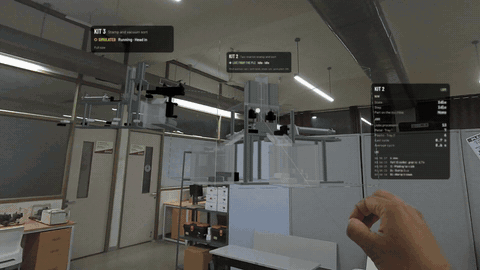

# Rig Monitor: remote dashboard for the pneumatic kits

A read-only dashboard for the Micro850 rig, written in React Native (Expo) so the same code
runs in a browser today and as an Android / iOS app later.

**Status on 2026-11-17:** the gateway, the cloud relay and the app all run and were checked end to end on the rig PC: the app reads the real controller through the relay. The web app is **not hosted yet**, so it only opens on the rig PC for now. The lab is being moved and the PLC is not wired to a kit, so the app opens on its built-in simulation; switch to "Live rig" at the top of the page.

## How the data travels

```
Micro850 PLC  --EtherNet/IP, read only-->  PlcGateway (rig PC)  --HTTPS, outbound-->  cloud relay  -->  app anywhere
                                                  |
                                                  +--> app on the same PC / network (direct)
```

- **`Tools/PlcGateway`** (.NET) finds the controller, works out which kit program is loaded, reads
  its variables about eight times a second and serves one JSON snapshot. It uses the same
  EtherNet/IP client as the Unity twin, which can only read.
- **Cloud relay** (`Dashboard/cloud/schema.sql`, Supabase): one table holding the latest snapshot
  per machine. The gateway pushes to it; the app subscribes to it. The rig PC only makes outbound
  connections, so nothing on the factory network is exposed to the internet.
- **`Dashboard/app`** (Expo, TypeScript): the dashboard.

Nothing in this chain can write to the PLC. The gateway refuses every HTTP method except GET.

## What the dashboard shows

It opens on the **floor**: every station as a card (state, current step, progress through the
cycle, parts, last cycle time), counts of stations running / idle / stopped on a fault / not
reporting, a "Needs attention" list, and the events of all stations together. Opening a station
gives its own pages:

| Tab | Content |
|---|---|
| Overview | Machine state, current step and time in it, part on the machine, cycle progress, parts sorted, cycle times, actuator positions, recent events |
| Signals | Every input and output with its panel jack, and the program's timing settings |
| Log | Step changes, parts sorted, faults, link up / down since the gateway started |
| About | Controller, address, read time, data route, read-only notice |

If the controller holds a program with no profile, the dashboard still shows the raw inputs and
outputs. If data stops arriving, values are marked "last known" and then hidden; it never shows
old values as live.

Kit profiles live in `Tools/PlcGateway/profiles/*.json` (variable names, step names, fault texts,
jack labels). Adding a kit is adding a file there; the app needs no change.

## Run it on the rig PC

Needs the .NET SDK and Node.js LTS (both installed on the rig PC).

1. Gateway, from `Tools/PlcGateway`:

   ```
   dotnet run
   ```

   Add `-- --demo` to play a simulated Kit 3 cycle with no PLC, `-- --lan` to let other devices
   on the same network connect, `-- --port 9000` for another port.

2. App, from `Dashboard/app`:

   ```
   start-web.cmd
   ```

   Then open `http://localhost:8081`. To point the page at another gateway, add
   `?gateway=http://host:port` to the address.

Check the gateway alone with `http://localhost:8787/api/state`.

## Design

"Quiet instrument" style, after high-performance HMI practice (ISA-101): a calm putty-grey
surface, state shown in ink and one cool data colour, and saturated colour kept for faults and
lost data. State is never shown by colour alone. Light and dark follow the device setting.
Type: Barlow Condensed (labels), Barlow (text), IBM Plex Mono (values).

## Stations

| Station | Live from the PLC | Simulation | 3D model |
|---|---|---|---|
| Kit 1, metal / plastic sort | yes, when the Kit 1 program is in the controller | yes | yes |
| Kit 2, two-station stamp and sort | yes, when the Kit 2 program is in the controller | yes, following the Unity twin's sequence | yes |
| Kit 3, stamp and vacuum sort | yes, when the Kit 3 program is in the controller | yes | yes |
| Kit 4, conveyor sort | no: no PLC program or wiring yet | yes, sequence **assumed** from the CAD | yes |
| Kit 5, assembly and inspection | no: no PLC program or wiring yet | yes, sequence **assumed** from the CAD | yes |

There is one controller on the rig and it runs one kit's program at a time, so in the live view
at most one station is live and the others read "Not connected". A program with no profile shows
as an extra "Controller" card with raw inputs and outputs.

Adding a station: a profile in `Tools/PlcGateway/profiles` (live data), and in the app a profile
copy plus a `.sim.ts` in `src/kits`, an entry in `src/kits/stations.ts`, and optionally a model
entry in `src/kits/twins.ts`.

## 3D models

Each station shows its own CAD model: the same components the Unity twin uses
(`Assets/Models/KitN/KitN_components.obj`), moved by the rules in the Unity scripts. The component
numbers, strokes and directions are collected in `src/kits/twins.ts`, with the script each one
comes from. Positions follow the PLC's commands; most cylinders on the rig have no sensors.
A released part is shown dropping into its bin in a simplified way; Unity uses full physics there.

The OBJ files are 75 to 170 MB, far too large for a phone or a browser.
`Dashboard/tools/obj-to-glb.mjs` (no dependencies) converts each to about 2 MB by merging vertices
on a 0.6 mm grid and keeping the component names:

```
node --max-old-space-size=6000 Dashboard/tools/obj-to-glb.mjs Assets/Models/Kit3/Kit3_components.obj Dashboard/app/public/models/kit3.glb 0.6
```

The 3D view is web-only for now; the mobile build needs the models bundled as assets.

### Kit 4 and Kit 5: from the Solid Edge IGES files

Kit 4 and Kit 5 only exist as IGES exports (`4th_Kit final.igs`, `5th_kit final.igs`; not in the
repo). OpenCascade reads them but returns each kit as one lump, so nothing could move on its own,
and a cylinder could only move as a whole. `Dashboard/tools/iges-to-glb.mjs` fixes that:

- it reads the assembly tree from the IGES file itself (`iges-structure.mjs`: entities 308 / 408
  say which faces belong to which part) and matches it to OpenCascade's faces, which stay in file
  order. The script stops if the face counts do not agree;
- every part becomes its own mesh (`P001`, `P002`, ...), and a part whose faces do not all touch
  is split into its pieces (`P003_1`, `P003_2`);
- each cylinder comes out as barrel, mounting and **rod** as three separate meshes, so the rod and
  the pusher fixed to it move while the barrel stays put.

```
cd Dashboard/tools
npm install
node --max-old-space-size=6000 iges-to-glb.mjs "<path>/4th_Kit final.igs" ../app/public/models/kit4.glb
node iges-tree.mjs "<path>/4th_Kit final.igs"      # the assembly tree
```

The converter writes a `.report.json` beside the GLB with every mesh's box; the part numbers in
`src/kits/twins45.ts` were read from it. What these two kits do, their strokes and their step
sequence are worked out from the geometry and are **not confirmed**. Kit 4's fourth cylinder,
which faces the diverter across the belt, is left still because its job is not known.

## AR view (Meta Quest)



[Download the full recording from the headset](../Presentation/kit-digital-twin/videos/quest-ar-demo.mp4?raw=true) (5 min 42 s, 2026-11-19, MP4, 41 MB).

"AR view" at the top of the page (or `?ar=all`, `?ar=kit1` in the address) shows the stations in
the room through a headset's passthrough, using WebXR in the headset's own browser: no app to
install. `src/components/ArView.tsx` reuses the models and motion of the 3D view.

- **All stations around me**: every station on an arc at half size, for looking at the lab from
  somewhere else.
- **One station at full size**: to stand beside the real one.

A station whose program is in the controller follows the live feed; every other station plays the
in-app simulation. Each label says which ("Live from the PLC" / "Simulated").

In AR, with bare hands (hand tracking) or the controllers:

- point at a station and pinch (or hold the trigger) to carry it;
- take it with both hands and pull them apart or turn them to resize and turn it;
- a quick pinch opens its information board: step, part, job counters, cycle times, log;
- the menu down to the viewer's left can be pinched or pressed with a fingertip: Show (all
  stations, or each one alone), Info, Full size, Reset places, Exit AR;
- controllers add: thumbstick to turn and reel in or out, A / X and B / Y to resize, grip for
  full size.

Where a station is put is held to the room with a WebXR anchor and kept as a persistent anchor
(its id and the station's size are in the browser's local storage), so it is there again in the
next session. "Reset places" drops them. `&info=1` in the address opens every board from the start.

WebXR only runs on `https` or `localhost`. The hosted site (`https://rig-monitor.vercel.app/?ar`)
works in the Quest browser with no cable. To try local changes, `quest-usb.cmd` in `Dashboard/app`
forwards the development server to the headset over USB and opens the page there.

### Quest app

`Dashboard/quest-app` packages the hosted site as an installable Quest app (a Trusted Web Activity
made with Meta's Bubblewrap, package `app.vercel.rigmonitor.quest`). It loads the hosted site at
`/?ar=all&auto=1` and goes straight into AR, so a new deployment of the site updates the app
without a reinstall. Confirmed working on a Quest 3 on 2026-11-19.

It must stay an **immersive** app (`horizonOSAppMode` in `twa-manifest.json`): packaged as a 2D
window the headset offers the page no AR. An immersive app has no 2D page, which is why the AR view
starts its session by itself (`auto=1`) and has the Show panel to pick stations.

- `twa-manifest.json` is the project; the site's `public/manifest.json` and
  `public/.well-known/assetlinks.json` (which names the signing certificate) belong to it.
- `android.keystore` and `signing.local.txt` (its password) are **not in git**. Keep them: an
  update can only be installed over the app if it is signed with the same key.
- Rebuild: `bubblewrap update --skipVersionUpgrade`, replace `jcenter()` with `mavenCentral()` in
  `build.gradle`, `gradlew.bat assembleRelease`, then `zipalign` and `apksigner` from Android
  build-tools 34 (`bubblewrap build` fails on Windows with current Node: "spawn EINVAL").
  The JDK and Android SDK paths are in `~/.bubblewrap/config.json`.
- Install: `adb install -r rig-monitor-quest.apk`; it appears under **Unknown sources** in the
  headset's app library.

**Status on 2026-11-19:** checked in a desktop browser (layout, labels, live / simulated feeds),
and entering AR was confirmed on a Quest 3 over USB. Each control (carry, turn, resize) has not
been checked one by one.

## Simulation

"Simulation" at the top of the page runs all three stations inside the app (`src/sim/engine.ts`
with one definition per kit in `src/kits`), with no gateway, PLC or network. Kit 1 pauses now and
then for a magazine refill and Kit 2 raises an occasional fault, so the floor view has something
to show. It is always labelled as simulated.
`EXPO_PUBLIC_DEFAULT_VIEW=demo` makes it the opening view; set it to `live` once the rig is back.

## Cloud relay

Set up on 2026-11-17 in the existing Supabase project `portfolio` (tables `machine_state`,
`machine_ingest_keys`, function `ingest_machine_state`; see `Dashboard/cloud/schema.sql`).
The machine id is `rig-1`.

- The gateway reads `Tools/PlcGateway/cloud.json` (URL, publishable key, machine id, ingest
  token). It is ignored by git; never commit it. Without it the gateway runs with the relay off.
- The app reads `Dashboard/app/.env` at build time (URL and publishable key; also ignored).
- To set up another machine or project: run `schema.sql`, make a long random token, store its
  SHA-256 in `machine_ingest_keys`, and fill in `cloud.json` and `.env` from the example files.

The gateway also serves the built app itself: copy `Dashboard/app/dist` to a `wwwroot` folder
next to the gateway's executable and open `http://localhost:8787`.

Anyone who has the app's address can read the machine state. Add sign-in before sharing it
widely, and before any write feature.

## Later

- Mobile builds (EAS) from the same code.
- Sign-in, then write commands (start / stop / reset) through `K3_HMI_*`, behind a separate,
  deliberately enabled path.
